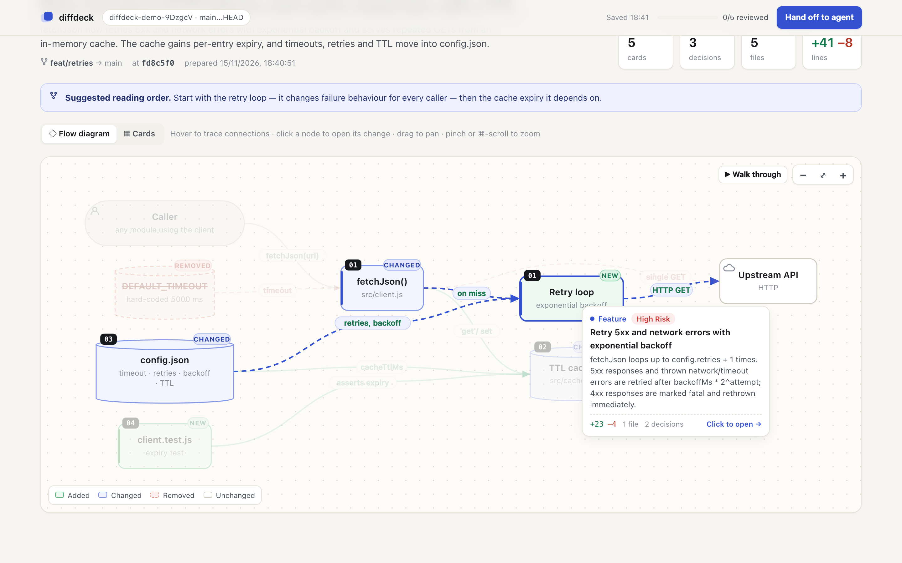
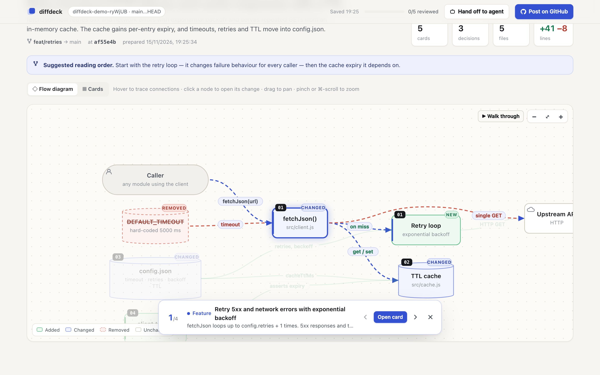

<div align="center">

# diffdeck

**See a pull request instead of reading it.**

Turn a pull request, a branch or a single commit into an interactive flow diagram,
review it visually, and send your feedback to a coding agent or to GitHub.

Runs on your machine. No dependencies. Node 18+.

<br>



</div>

---

## Contents

- [What it does](#what-it-does)
- [Requirements](#requirements)
- [Quick start](#quick-start)
- [Installation](#installation)
- [Usage](#usage)
  - [1. Set up a repository](#1-set-up-a-repository)
  - [2. Break down a change](#2-break-down-a-change)
  - [3. Review in the browser](#3-review-in-the-browser)
  - [4. Finish the review](#4-finish-the-review)
  - [Reviewing several repositories](#reviewing-several-repositories)
- [Commands](#commands)
- [Features](#features)
- [How it works](#how-it-works)
- [Help](#help)
- [FAQ](#faq)
- [Development](#development)

---

## What it does

- **Breaks down a change** (a PR, a branch or a commit) into cards grouped by intent, with the help of your coding agent
- **Draws a system flow diagram** of the parts the change touches, with added, changed and removed parts in different colors
- **Draws a logic flowchart** for each change; click a step to see its exact lines of code
- **Shows the design decisions** behind the change, with alternatives and their pros and cons
- **Collects your feedback**: line notes, approvals, requested changes and preferred alternatives
- **Finishes in one click**: hand the feedback to your agent to implement, or post it on the pull request as a GitHub review

Works with Claude Code, Cursor and OpenCode out of the box, and with any other agent (Codex, Aider, ...) through plain files.

## Requirements

- **Node.js 18 or newer** and **git**
- **GitHub CLI (`gh`)**, only for pull requests and for posting reviews:

  ```sh
  brew install gh                      # macOS
  winget install --id GitHub.cli       # Windows
  ```

  Linux: see [cli.github.com](https://github.com/cli/cli#installation).

## Quick start

```sh
# 1. Install (once per machine)
npm install -g github:AmeyaKasture/diffdeck

# 2. Set up your repository (once per repository)
cd your-repo
diffdeck init
```

```
# 3. In your coding agent, break down a change
/diffdeck-breakdown https://github.com/your-org/your-repo/pull/42
```

The agent analyses the change and opens the review in your browser. Review it, then click
**Hand off to agent** (and run `/diffdeck-apply`) or **Post on GitHub**.

Just want a look? Open a finished sample review, with nothing to install:

```sh
npx github:AmeyaKasture/diffdeck demo
```

---

## Installation

**Install**

```sh
npm install -g github:AmeyaKasture/diffdeck
diffdeck --version
```

**Upgrade**

```sh
diffdeck upgrade              # install the latest version, if there is one
diffdeck upgrade --force      # reinstall even if you are up to date
```

`upgrade` also refreshes the slash commands in the repository you run it from, and restarts the
review server so it runs the new version. Your reviews keep their addresses.

> Versions before 0.2.0 have no `upgrade` command. Update those once with
> `npm install -g github:AmeyaKasture/diffdeck`.

**Uninstall**

```sh
diffdeck stop --all           # stop the review server
npm uninstall -g diffdeck
rm -rf ~/.diffdeck            # list of reviewed repositories
```

Each repository you reviewed also has a `.diffdeck/` folder, which you can delete.

---

## Usage

A review has four steps:

| Step | Where | What you do |
|---|---|---|
| 1 | terminal | `diffdeck init` (once per repository) |
| 2 | your agent | `/diffdeck-breakdown <PR link, branch or commit>` |
| 3 | browser | explore, comment, approve, pick alternatives |
| 4 | browser, then agent | **Hand off to agent** and run `/diffdeck-apply`, or **Post on GitHub** |

### 1. Set up a repository

```sh
cd your-repo
diffdeck init                 # all supported agents
diffdeck init claude          # or only one: claude, cursor or opencode
```

This adds two slash commands:

- `/diffdeck-breakdown` analyses a change and opens the review
- `/diffdeck-apply` implements the feedback you leave in the review

The files are written to:

- `.claude/commands/` for Claude Code
- `.cursor/commands/` for Cursor
- `.opencode/command/` for OpenCode

Commit them if your team should have the commands too. For any other agent, `diffdeck init`
prints a short snippet to paste into `AGENTS.md`.

### 2. Break down a change

Give the agent a pull request, a branch or a commit:

```
/diffdeck-breakdown https://github.com/your-org/your-repo/pull/42
/diffdeck-breakdown 42
/diffdeck-breakdown feature/login
/diffdeck-breakdown a1b2c3d
```

diffdeck works out which kind you gave it:

- **Pull request** (link or number): the PR's diff, exactly as GitHub shows it. Needs `gh`.
- **Branch**: the branch compared with `main` (or `master`) from where it forked, like a PR.
  - It does not need to be checked out.
  - If it exists only on the remote, it is fetched.
  - If it is your current branch, uncommitted edits are included.
- **Commit**: that commit compared with the one before it, to show what this commit changed.
  - For a merge commit, it is compared with its first parent.
  - The very first commit of a repository is compared with an empty tree.

If you give nothing, the agent asks what to break down before doing anything.

The agent then:

1. collects the diff with `diffdeck prepare`
2. reads the diff and the surrounding code
3. writes the breakdown: system diagram, change cards, logic flowcharts and design decisions
4. checks its work with `diffdeck validate`
5. opens the review with `diffdeck serve`

It finishes with the review's address and its main findings:

```
The review is open at http://127.0.0.1:4777/your-repo/ (all reviews: http://127.0.0.1:4777/).
```

### 3. Review in the browser

- **Flow diagram** (home screen): hover a node to trace its connections; click it to open that change
- **Walk through**: steps through the changes in the suggested reading order
- **Logic flow**: click a step to jump to its code; click a decision diamond to compare alternatives
- **Code diff**: click a line number to leave a note on that line
- **Prefer this approach**: asks for a different design alternative
- **Approve** or **Request changes** on each card
- **Cards** view: the same changes as a list

Everything is saved as you go, to `.diffdeck/feedback.md`.

### 4. Finish the review

Use one of the two buttons at the top right of the page.

**Hand off to agent.** Then, in your agent:

```
/diffdeck-apply
```

The agent implements every requested change and leaves approved cards untouched.

**Post on GitHub.** Your notes become a review on the pull request:

- line notes become inline comments
- design decisions and card notes form the summary
- you choose **Comment**, **Request changes** or **Approve**
- you see a preview and confirm before anything is posted

The same from the terminal:

```sh
diffdeck login                                # once, if gh is not logged in
diffdeck post                                 # preview; nothing is sent
diffdeck post --yes                           # post it
diffdeck post --yes --event request-changes   # choose the review type
```

### Reviewing several repositories

One background server hosts all your reviews, each at its own address:

```
http://127.0.0.1:4777/                  all reviews, with their progress
http://127.0.0.1:4777/agentic-cloud/    one repository's review
http://127.0.0.1:4777/diffdeck/         another repository's review
```

- Running `diffdeck` in another repository adds it next to the others. Nothing is stopped or replaced.
- If two different repositories share a folder name, the second gets `-2` (for example `/api/` and `/api-2/`).
- Each repository has one review at a time. Breaking down something else in the same repository replaces it.

```sh
diffdeck list                 # every review and its address
diffdeck stop                 # remove this repository's review
diffdeck stop --all           # stop the server and every review
```

---

## Commands

Run `diffdeck --help` for the same list in your terminal.

### Review

| Command | What it does |
|---|---|
| `diffdeck` | Open this repository's review. Reuses whatever was prepared (PR, branch or commit); if nothing was, reviews the current branch against `main` |
| `diffdeck review <target>` | Review a PR link or number, a branch or a commit. The kind is detected automatically |
| `diffdeck review --pr <number or link>` | Review a pull request |
| `diffdeck review --branch <name>` | Review a branch against `main` |
| `diffdeck review --branch <name> --base <branch>` | Review a branch against another base branch |
| `diffdeck review --commit <id>` | Review one commit against its parent |
| `diffdeck review --base <branch>` | Review the current branch against another base branch |
| `diffdeck review --staged` | Review staged changes only |
| `diffdeck review --worktree` | Review uncommitted changes against `HEAD` |
| `diffdeck demo` | Open a finished sample review |

Examples:

```sh
diffdeck review https://github.com/your-org/your-repo/pull/42
diffdeck review feature/login
diffdeck review feature/login --base develop
diffdeck review a1b2c3d
```

### Server

| Command | What it does |
|---|---|
| `diffdeck serve` | Open this repository's review without collecting the diff again. Starts the server if needed |
| `diffdeck serve --foreground` | Run the server in this terminal (Ctrl+C stops it); useful for debugging |
| `diffdeck list` | Show every review on the server and its address |
| `diffdeck stop` | Remove this repository's review; the server stops when none are left |
| `diffdeck stop --all` | Stop the server and every review on it |

### GitHub

| Command | What it does |
|---|---|
| `diffdeck login` | Log in to GitHub through `gh` (opens a browser login) |
| `diffdeck post` | Preview the GitHub review; nothing is sent |
| `diffdeck post --yes` | Post the review |
| `diffdeck post --yes --event <type>` | Choose `comment`, `request-changes` or `approve` |
| `diffdeck post --yes --force` | Post again even if the same review was already posted |

### Agents

| Command | What it does |
|---|---|
| `diffdeck init` | Add `/diffdeck-breakdown` and `/diffdeck-apply` for Claude Code, Cursor and OpenCode |
| `diffdeck init <agent>` | Only for `claude`, `cursor` or `opencode` |
| `diffdeck prepare <target>` | Collect the diff only (this is what agents run) |
| `diffdeck validate` | Check the agent's `breakdown.json` and list any errors |
| `diffdeck feedback` | Print your feedback (`.diffdeck/feedback.md`) |

### Maintenance

| Command | What it does |
|---|---|
| `diffdeck upgrade` | Update to the latest version |
| `diffdeck upgrade --force` | Reinstall the current version |
| `diffdeck --version` | Print the installed version |
| `diffdeck --help` | List every command |

### Options

| Option | Meaning |
|---|---|
| `--port <n>` | Port for the server (default `4777`, or the next free port) |
| `--no-open` | Do not open the browser |
| `--version` | Print the version |
| `--help` | Print help |

### Environment variables

| Variable | Meaning |
|---|---|
| `DIFFDECK_PORT` | Default port for the server |
| `DIFFDECK_HOME` | Where the list of reviews is kept (default `~/.diffdeck`) |
| `DIFFDECK_NO_OPEN=1` | Never open a browser (useful in scripts) |
| `NO_COLOR=1` | Plain terminal output, without colors |

---

## Features

### System flow diagram

The home screen shows the parts of your system the change touches (callers, modules,
services, caches, config) and how they connect.

- Green: **added**. Blue: **changed**. Red and dashed: **removed**. White: unchanged context.
- Hover a node to trace its connections; click it to open that change.
- **Walk through** moves from one change to the next in reading order.
- Drag to pan. Pinch or Cmd/Ctrl-scroll to zoom. The **fit** button fits the diagram to the screen.



### Logic flowchart for every change

Each change opens on a flowchart of what the code does after the change: steps,
decision diamonds with yes/no branches, and input/output steps.

- Click a step to see its exact lines highlighted in the code diff.
- Click a decision diamond to compare the design alternatives, with pros and cons.
- Choose **Prefer this approach**, and the diagram labels the diamond with your choice.


### Code diff

- Syntax highlighting and word-level change marks
- Line numbers for both the old and the new version
- Toggle between *this change only* and *whole files*
- Click a line number to leave a note


### Two ways to finish


**Hand off to agent** saves everything to `.diffdeck/feedback.md`:

- approvals and requested changes per card
- preferred alternatives, with their trade-offs written out
- line notes with `file:line` references
- an overall comment

<details>
<summary>Example <code>feedback.md</code></summary>

```markdown
## Requested changes (1 card)

### Retry 5xx and network errors with exponential backoff  `retry-loop`
Files: `src/client.js`

- **Change design decision:** Which failures should be retried?
  - Current: **5xx and network errors** - Retry server errors and anything thrown by fetch.
  - Switch to: **Idempotent methods only** - Retry only GET/HEAD/PUT/DELETE.
  - Expected benefits: No duplicated writes; Matches HTTP semantics
  - Accepted trade-offs: POST callers get no resilience
  - Reviewer note: POSTs must not be retried.
- **`src/client.js:21`** (line in the new version):
  `await sleep(config.backoffMs * 2 ** attempt);`
  Skip the sleep after the last attempt.

## Approved - do not change
- Move timeout, retries, backoff and TTL into config.json `config-knobs`
```
</details>

**Post on GitHub** guides you through every step and guards against mistakes:

- **`gh` not installed**: shows the install command for your system.
- **Not logged in**: **Log in with GitHub** shows a one-time code; **Copy code & open GitHub** finishes the login in your browser. diffdeck never sees your password or token.
- **No remote or no pull request**: explains why and gives the command to fix it.
- **The PR changed since you reviewed it**: every line note is re-checked against the PR's current diff; notes that no longer match go into the summary instead of landing on the wrong line.
- **Your own PR**: only *Comment* is offered, because GitHub does not let you approve your own PR.
- **Closed PR or nothing to post**: posting is disabled, with the reason.
- **Already posted**: shows a link to the earlier review and posts again only if you confirm.
- **Every post**: needs you to confirm that it is public.

---

## How it works

```
  PR, branch or commit
          |
          v
  diffdeck prepare   -->  .diffdeck/diff.patch, hunks.md, AGENT_TASK.md
          |
          v
  your agent         -->  .diffdeck/breakdown.json   (diagrams, cards, decisions)
          |
          v
  browser review     -->  .diffdeck/feedback.md      (saved as you review)
          |
          v
  your agent         -->  code changes
  or Post on GitHub  -->  a pull request review
```

All files live in `.diffdeck/` at the repository root. diffdeck adds that folder to
`.git/info/exclude`, so it never appears in `git status` and your `.gitignore` is not changed.

| File | Written by | Purpose |
|---|---|---|
| `diff.patch`, `diff.json`, `hunks.md` | `prepare` | The diff, parsed, with an index of its hunks |
| `AGENT_TASK.md`, `breakdown.schema.json` | `prepare` | Instructions and output format for the agent |
| `breakdown.json` | agent | Diagrams, change cards, flowcharts and design decisions |
| `feedback.json` | browser | Your review state, restored when you reopen it |
| `feedback.md` | browser | The hand-off for the agent |

When you prepare a different diff, the old breakdown and feedback are kept as `*.prev`,
because their line references no longer match.

<details>
<summary><b>The breakdown format</b></summary>

The full format is in [`schema/breakdown.schema.json`](schema/breakdown.schema.json).

```jsonc
{
  "title": "Retry transient HTTP failures and cache responses with a TTL",
  "summary": "...",
  "reviewOrder": "Start with the retry loop ...",
  "flow": {                                   // system diagram (home screen)
    "direction": "LR",
    "nodes": [
      { "id": "fetch", "label": "fetchJson()", "sub": "src/client.js",
        "type": "component", "change": "modified", "card": "retry-loop" },
      { "id": "api", "label": "Upstream API", "type": "service" }
    ],
    "edges": [{ "from": "fetch", "to": "api", "label": "HTTP GET", "change": "added" }]
  },
  "cards": [{
    "id": "retry-loop", "title": "Retry 5xx and network errors", "kind": "feature", "risk": "high",
    "summary": "...", "why": "...",
    "refs": [{ "file": "src/client.js", "hunks": [0] }],   // the diff hunks this card covers
    "decisions": [{
      "question": "Which failures should be retried?",
      "chosen":       { "label": "5xx and network errors", "description": "...", "pros": ["..."], "cons": ["..."] },
      "alternatives": [{ "label": "Idempotent methods only", "description": "...", "pros": ["..."], "cons": ["..."], "effort": "small" }]
    }],
    "flow": {                                 // logic flowchart for this card
      "nodes": [
        { "id": "retryable", "label": "5xx or network error?", "shape": "decision",
          "change": "added", "decision": 0, "ref": { "file": "src/client.js", "lines": [14, 14] } }
      ],
      "edges": [{ "from": "retryable", "to": "left", "label": "yes" }]
    }
  }]
}
```

- Node `type`: `actor`, `component`, `service`, `data`, `external`
- Flowchart `shape`: `start`, `end`, `step`, `decision`, `io`
- `change`: `added`, `modified`, `removed`, `unchanged`
</details>

---

## Help

### Built-in help

```sh
diffdeck --help               # every command and option
diffdeck --version            # the installed version
diffdeck list                 # where your reviews are
diffdeck validate             # what is wrong with a breakdown
```

### Troubleshooting

**`diffdeck: command not found`**

The global npm folder is not on your `PATH`, or the install failed. Reinstall and check:

```sh
npm install -g github:AmeyaKasture/diffdeck
npm prefix -g                 # its bin/ folder must be on your PATH
```

**`EACCES` permission error during install or upgrade**

Your global npm folder needs administrator rights. Either run the command with `sudo`, or
[set npm up to install without it](https://docs.npmjs.com/resolving-eacces-permissions-errors-when-installing-packages-globally).

**The agent says `diffdeck prepare` does not accept a PR link, a branch or a commit**

You are on an old version. Upgrade, then refresh the repository's slash commands:

```sh
diffdeck upgrade
diffdeck init
```

**The page says "No breakdown yet"**

The agent has not finished, or it never ran. Run `/diffdeck-breakdown` in your agent; the
page updates by itself when the breakdown is written. If the agent finished but the page
still shows this, check the breakdown:

```sh
diffdeck validate
```

**The review address does not open**

The server may have stopped (for example after a restart). Run `diffdeck` in the repository
to start it again; the address stays the same.

**A pull request cannot be found, or posting fails**

Check that `gh` is installed and logged in, and that you run diffdeck inside the PR's repository:

```sh
gh auth status
diffdeck login
gh pr view <number>
```

**"... is already merged into main"**

A merged branch has nothing left to compare. Review its merge commit or its pull request instead.

**"Could not find a pull request, branch or commit called ..."**

Check the spelling, or fetch first with `git fetch`. To say exactly what you mean, use
`--pr`, `--branch` or `--commit`.

**Port 4777 is already in use**

diffdeck picks the next free port automatically and prints the address. To choose the port
yourself, restart the server on it:

```sh
diffdeck stop --all
diffdeck serve --port 4800
```

**Start from scratch**

```sh
diffdeck stop --all
rm -rf .diffdeck              # in the repository
diffdeck
```

### Report a problem

Open an issue at [github.com/AmeyaKasture/diffdeck/issues](https://github.com/AmeyaKasture/diffdeck/issues) with:

- the output of `diffdeck --version`
- the command you ran and the full message it printed
- your operating system and `node --version`

---

## FAQ

**Does my code leave my machine?**

No. The server listens only on `127.0.0.1` and rejects requests from other sites. GitHub is
contacted only through `gh`, and only when you fetch a PR or post a review you have confirmed.
`diffdeck upgrade` downloads the new version from GitHub when you run it.

**Can I use it without an AI agent?**

Yes. Without a breakdown, the diagram shows the changed files grouped by folder, and each file
opens as its own card with the full diff, line notes and approvals.

**Which agent works best?**

Any capable model. `AGENT_TASK.md` gives detailed instructions, and `diffdeck validate` catches
mistakes such as references to lines that do not exist.

**How does it handle large pull requests?**

The agent groups the change into 3 to 15 cards by intent. The diagrams lay themselves out
automatically, and you can pan, zoom and fit them to the screen.

**Does it work on Windows and Linux?**

Yes. It needs only Node 18+ and git.

**What does a posted review look like?**

Line notes appear as inline comments on the exact lines. The summary lists the cards that need
changes, the alternatives you preferred, and the cards that look good. diffdeck adds no
signature or branding.

---

## Development

```sh
git clone https://github.com/AmeyaKasture/diffdeck.git
cd diffdeck
npm link                      # use this clone as your diffdeck command
npm test
node bin/diffdeck.js demo
```

- `bin/` is the command-line interface
- `lib/` holds diff parsing, validation, the server, GitHub posting and the agent instructions
- `ui/` is plain HTML, CSS and JavaScript, with no build step; `ui/graph.js` is the diagram layout engine
- `schema/` holds the breakdown format
