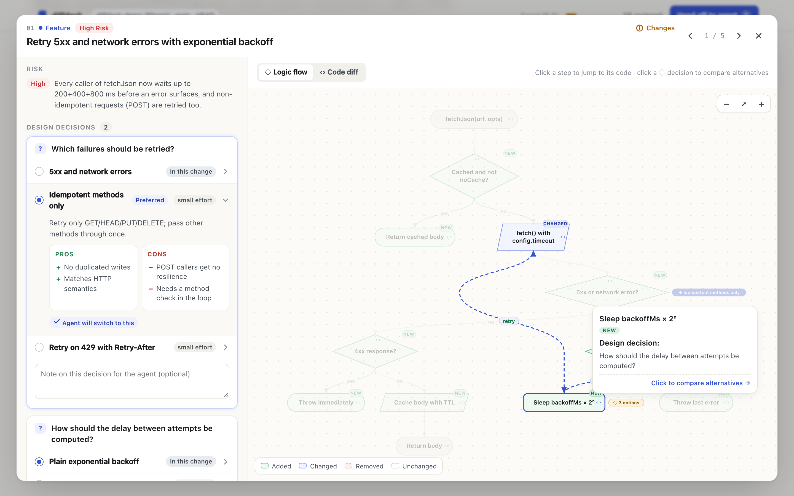
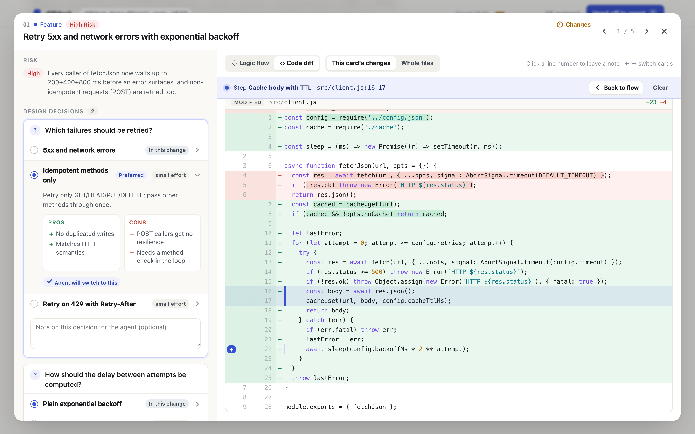
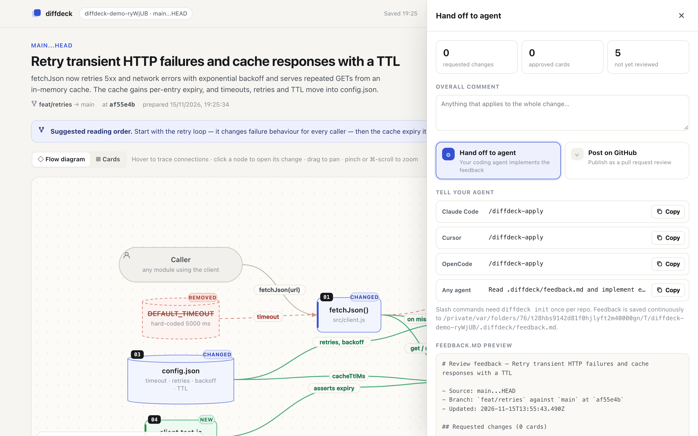

<div align="center">

# diffdeck

**See a pull request instead of reading it.**

diffdeck turns a git diff or GitHub PR into an interactive flow diagram.
Click any part to see its logic as a flowchart, jump to the exact lines of code,
compare the design alternatives with their pros and cons, then either hand your
feedback to **any coding agent** (Claude Code, Cursor, OpenCode, Codex, Aider, …)
or **post it as a review on the GitHub pull request**.

Runs entirely on your machine · zero dependencies · Node 18+

<br>


</div>

---

## Try it in 10 seconds

```sh
npx github:AmeyaKasture/diffdeck demo
```

This builds a small sample repository with a ready-made breakdown and opens it in
your browser. You need no agent and no setup.

## Install

```sh
npm install -g github:AmeyaKasture/diffdeck
```

<details>
<summary>Other ways to install</summary>

```sh
# From a clone, so your installed version follows git pull
git clone https://github.com/AmeyaKasture/diffdeck.git
cd diffdeck && npm link

# Without installing: run any command through npx
npx github:AmeyaKasture/diffdeck <command>
```
</details>

## Quick start

```sh
cd your-repo
diffdeck init        # once per repo: adds /diffdeck-breakdown and /diffdeck-apply to your agents
```

Then a review takes three steps:

| | Where | What to type | What happens |
|---|---|---|---|
| **1** | your agent | `/diffdeck-breakdown <PR link>` | The agent reads the pull request and draws the diagrams, flowcharts and design alternatives |
| **2** | terminal | `diffdeck` | The review of that PR opens in your browser. Explore it, comment, approve, and pick alternatives |
| **3** | your agent | `/diffdeck-apply` | The agent implements your feedback |
| *or 3* | browser | **Finish review**, then **Post on GitHub** | Your notes become a PR review with inline comments |

For example:

```
/diffdeck-breakdown https://github.com/your-org/your-repo/pull/42
```

If you run `/diffdeck-breakdown` without a link, the agent asks you for one before doing
anything. If you have no pull request yet, tell it which base branch to compare against
instead.

Once a PR has been prepared, plain `diffdeck` keeps reviewing that PR. Run
`diffdeck review <other PR link>` to switch.

> **Agent without slash commands?** For step 1, tell it *"Run `diffdeck prepare --pr <PR link>`,
> then follow `.diffdeck/AGENT_TASK.md`"*. For step 3, tell it *"Implement `.diffdeck/feedback.md`"*.
> All communication happens through plain files, so every agent can take part.

## What you get

### 1. A system flow diagram of the change

The home screen shows the parts of your system that the change touches, such as callers,
modules, services, caches and config, and how they connect.

- Colors show what changed: green for **added**, blue for **changed**, red with a dashed, struck-through outline for **removed**, and white for unchanged context
- **Hover** a node to trace its connections; the related edges animate and everything else fades
- **Click** a node to open that change
- **Walk through** moves from one change to the next in the suggested reading order
- Drag to pan; pinch or Cmd/Ctrl-scroll to zoom; the **fit** button fits the diagram to the screen


### 2. A logic flowchart for every change

Each change opens on a flowchart of what the code does after the change: steps,
decision diamonds with yes/no branches, and I/O steps.

- **Click a step** to jump to the code diff with exactly those lines highlighted
- **Click a decision diamond** to compare the design alternatives side by side
- Choose **Prefer this approach**, and the diagram labels the diamond with the alternative you picked



### 3. The real code, one click away

The diff viewer has syntax highlighting, word-level change marks, and line numbers for
both the old and new versions. Toggle between *this change only* and *whole files*.
Click any line number to leave a note on that line.



### 4. Finish: hand off to an agent, or post on GitHub

**Finish review** offers two ways to act on what you decided.



**Hand off to agent.** Everything you do is saved continuously to `.diffdeck/feedback.md`:
approvals, requested changes, preferred alternatives (with their trade-offs written out),
line notes with `file:line` references, and an overall comment. Copy the prompt for your
tool, and the agent implements the requested changes while leaving approved cards untouched.

**Post on GitHub.** Your review is published on the pull request through the
[GitHub CLI](https://cli.github.com): line notes become inline comments, while design
decisions and card notes form the summary. You choose *Comment*, *Request changes* or
*Approve*. diffdeck guides you through each step and guards against mistakes:

| Situation | What diffdeck does |
|---|---|
| `gh` is not installed | Shows the install command for your OS, then **Check again** |
| Not logged in | **Log in with GitHub** starts GitHub's device login: diffdeck shows the one-time code, and **Copy code & open GitHub** finishes it in your browser. The page continues automatically, and diffdeck never sees your password or token |
| No remote or no PR for the branch | Explains why and gives the command to fix it (`gh pr create --fill`, or `diffdeck review --pr <n>`) |
| The PR changed after you reviewed, or the review includes uncommitted or unpushed lines | Warns you, re-checks every line note against the PR's **current** diff, and moves notes that no longer match into the summary rather than misplacing them |
| It is your own PR | Offers only *Comment*, because GitHub forbids approving or requesting changes on your own PR |
| The PR is closed or merged, or there is nothing to post | Disables posting and explains why |
| The same review was already posted | Shows a link to it and posts again only if you tick *Post it again anyway* |
| Every post | Requires you to confirm *"I understand this posts publicly on PR #N as @you"* |

The same flow works in the terminal: `diffdeck login`, then `diffdeck post` (preview),
then `diffdeck post --yes`.

<details>
<summary>Example <code>feedback.md</code></summary>

```markdown
## Requested changes (1 card)

### Retry 5xx and network errors with exponential backoff  `retry-loop`
Files: `src/client.js`

- **Change design decision:** Which failures should be retried?
  - Current: **5xx and network errors** — Retry server errors and anything thrown by fetch.
  - Switch to: **Idempotent methods only** — Retry only GET/HEAD/PUT/DELETE.
  - Expected benefits: No duplicated writes; Matches HTTP semantics
  - Accepted trade-offs: POST callers get no resilience
  - Reviewer note: POSTs must not be retried.
- **`src/client.js:21`** (line in the new version):
  `await sleep(config.backoffMs * 2 ** attempt);`
  Skip the sleep after the last attempt.

## Approved — do not change
- Move timeout, retries, backoff and TTL into config.json `config-knobs`
```
</details>

## Commands

| Command | What it does |
|---|---|
| `diffdeck` | Reviews the PR prepared earlier; if there is none, reviews the current branch against `main`/`master` (auto-detected; uncommitted edits included). Opens the browser |
| `diffdeck review <PR link>` | Reviews a GitHub pull request (requires the [`gh`](https://cli.github.com) CLI) |
| `diffdeck review <base>` | Reviews against another branch, e.g. `diffdeck review develop` |
| `diffdeck review --pr 42` | The same, by PR number in the current repository |
| `diffdeck review --staged` | Reviews only staged changes |
| `diffdeck review --worktree` | Reviews uncommitted changes against `HEAD` |
| `diffdeck demo` | Opens the sample review |
| `diffdeck init [claude\|cursor\|opencode\|all]` | Adds the `/diffdeck-breakdown` and `/diffdeck-apply` commands to the repo |
| `diffdeck prepare [same options]` | Only collects the diff; this is what agents run |
| `diffdeck serve` | Only opens the UI for the prepared diff |
| `diffdeck post` | Previews your review for the pull request; nothing is sent |
| `diffdeck post --yes [--event comment\|request-changes\|approve]` | Posts the review on GitHub (`--force` re-posts an identical review) |
| `diffdeck login` | Logs in to GitHub through `gh` (browser device flow) |
| `diffdeck validate` | Checks the agent's `breakdown.json` and reports precise errors |
| `diffdeck feedback` | Prints `feedback.md` |

Options: `--port <n>` (default `4777`, then the next free port), `--no-open`, `--version`, `--help`.

Running `diffdeck` again on the same diff keeps the breakdown and your feedback.
When the diff changes, the old files are kept as `*.prev`, because their line
references would no longer match.

## Agent support

| Agent | Setup | Step 1 | Step 3 |
|---|---|---|---|
| Claude Code | `diffdeck init claude` (writes `.claude/commands/`) | `/diffdeck-breakdown <PR link>` | `/diffdeck-apply` |
| Cursor | `diffdeck init cursor` (writes `.cursor/commands/`) | `/diffdeck-breakdown <PR link>` | `/diffdeck-apply` |
| OpenCode | `diffdeck init opencode` (writes `.opencode/command/`) | `/diffdeck-breakdown <PR link>` | `/diffdeck-apply` |
| Anything else | add the snippet `diffdeck init` prints to `AGENTS.md` | "run `diffdeck prepare --pr <PR link>`, then follow `.diffdeck/AGENT_TASK.md`" | "implement `.diffdeck/feedback.md`" |

`/diffdeck-breakdown` needs a pull request link. Without one, the agent asks for it first.

## How it works

```
  gh pr diff <PR link>  (or git diff)
          |
          v
  diffdeck prepare  -->  .diffdeck/diff.patch, hunks.md, AGENT_TASK.md, breakdown.schema.json
          |
          v
  your agent        -->  .diffdeck/breakdown.json   (system flow, cards, logic flows, decisions)
          |
          v
  diffdeck (browser) --> .diffdeck/feedback.md      (saved as you review)
          |
          v
  your agent        -->  code changes   (or: Post on GitHub as a PR review)
```

Every file lives in `.diffdeck/` at the repository root. diffdeck adds that folder to
`.git/info/exclude`, so it never appears in `git status` and your `.gitignore` stays untouched.

| File | Written by | Purpose |
|---|---|---|
| `diff.patch`, `diff.json`, `hunks.md` | `prepare` | Raw diff, parsed diff, and an index of hunks for the agent |
| `AGENT_TASK.md`, `breakdown.schema.json` | `prepare` | Instructions and the exact output format for the agent |
| `breakdown.json` | agent | System flow, change cards, logic flowcharts, design decisions |
| `feedback.json` | browser | Review state, restored when you reopen the review |
| `feedback.md` | browser | The hand-off for the implementing agent |

<details>
<summary><b>breakdown.json at a glance</b></summary>

The full contract is in [`schema/breakdown.schema.json`](schema/breakdown.schema.json).

```jsonc
{
  "title": "Retry transient HTTP failures and cache responses with a TTL",
  "summary": "…",
  "reviewOrder": "Start with the retry loop …",
  "flow": {                                   // system diagram (home screen)
    "direction": "LR",
    "nodes": [
      { "id": "fetch", "label": "fetchJson()", "sub": "src/client.js",
        "type": "component", "change": "modified", "card": "retry-loop" },
      { "id": "api", "label": "Upstream API", "type": "service" }
    ],
    "edges": [{ "from": "fetch", "to": "api", "label": "HTTP GET", "change": "added" }]
  },
  "cards": [{
    "id": "retry-loop", "title": "Retry 5xx and network errors", "kind": "feature", "risk": "high",
    "summary": "…", "why": "…",
    "refs": [{ "file": "src/client.js", "hunks": [0] }],   // which diff hunks this card covers
    "decisions": [{
      "question": "Which failures should be retried?",
      "chosen":       { "label": "5xx and network errors", "description": "…", "pros": ["…"], "cons": ["…"] },
      "alternatives": [{ "label": "Idempotent methods only", "description": "…", "pros": ["…"], "cons": ["…"], "effort": "small" }]
    }],
    "flow": {                                 // logic flowchart for this card
      "nodes": [
        { "id": "retryable", "label": "5xx or network error?", "shape": "decision",
          "change": "added", "decision": 0, "ref": { "file": "src/client.js", "lines": [14, 14] } }
      ],
      "edges": [{ "from": "retryable", "to": "left", "label": "yes" }]
    }
  }]
}
```

Node `type`: `actor` · `component` · `service` · `data` · `external`.
Flowchart `shape`: `start` · `end` · `step` · `decision` · `io`.
`change`: `added` · `modified` · `removed` · `unchanged`.
</details>

## FAQ

**Does my code leave my machine?**
No. diffdeck makes no network requests of its own. The server listens only on
`127.0.0.1` and rejects requests from other origins. GitHub is contacted only through
`gh`, and only when you ask: to fetch a PR (`--pr`), to check which PR you are
reviewing, or to post a review you have confirmed.

**What does a posted review look like?**
Line notes appear as inline comments on the exact lines. The summary lists each
card that needs changes, any design alternatives you preferred (with the reason), and
the cards that look good. diffdeck adds no signature or branding.

**Can I use it without an AI agent?**
Yes. Without a breakdown, the diagram shows the changed files grouped by directory.
Each file opens as its own card with the full diff, line comments and approvals.
You can also write `breakdown.json` by hand.

**Which agent writes the best breakdowns?**
Any capable model will do. `AGENT_TASK.md` gives detailed instructions, and
`diffdeck validate` catches mistakes such as references to lines that don't exist,
edges between unknown nodes, or hunks that no card covers.

**Large PRs?**
The agent is asked to group the change into 3–15 cards by intent. The diagrams lay
themselves out automatically, and you can pan, zoom and fit them to the screen.

**Windows / Linux?**
Yes. diffdeck needs only Node 18+ and git. It opens your default browser with
`open`, `xdg-open` or `start`.

## Development

```sh
git clone https://github.com/AmeyaKasture/diffdeck.git && cd diffdeck
npm test                 # parser, validation and feedback tests
node bin/diffdeck.js demo
```

The UI is plain HTML, CSS and JavaScript in [`ui/`](ui), with no build step.
[`ui/graph.js`](ui/graph.js) holds a small layered-graph layout engine (in the
style of Sugiyama: ranking, crossing reduction, and placement with path-following
edge labels).

## License

[MIT](LICENSE)
